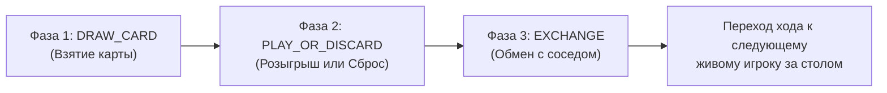
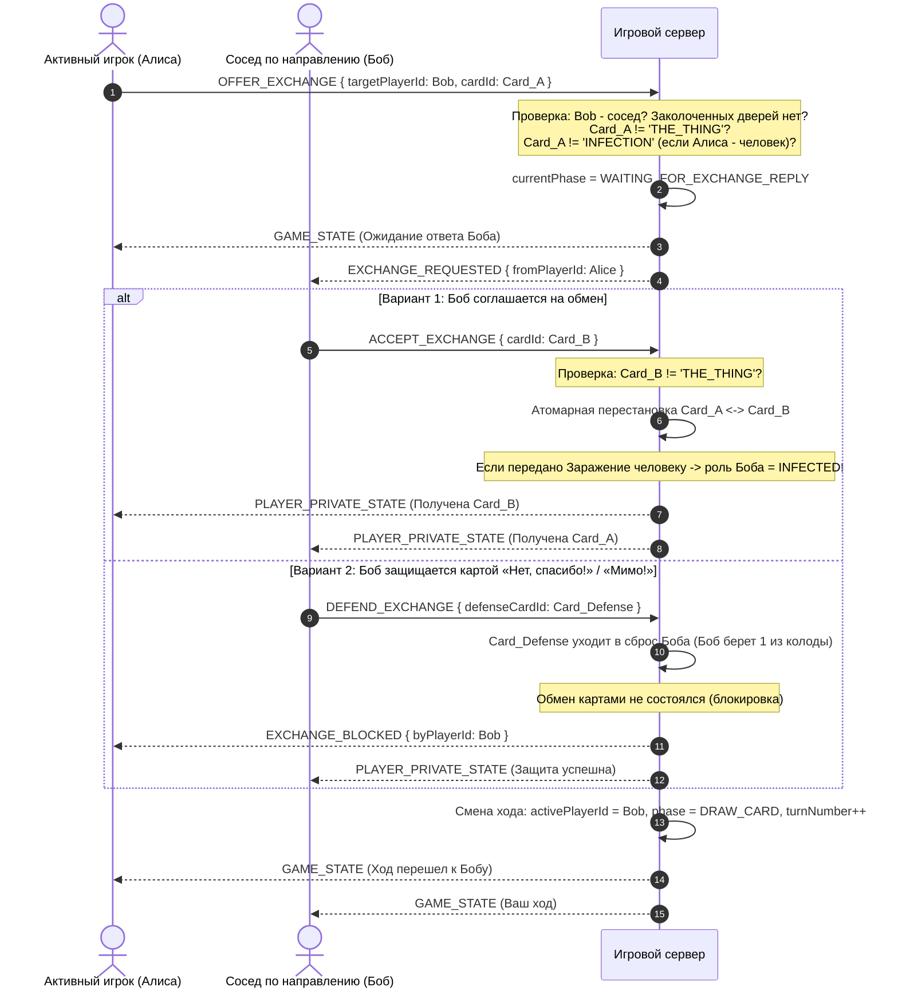

# Спецификация игрового протокола (Gameplay Protocol), скрытой рассылки карт (Zero Trust) и фаз хода (PO-6)

| Параметр | Значение |
| :--- | :--- |
| **Документ** | Спецификация игрового протокола, публичных/приватных DTO и 3 фаз хода |
| **Модуль** | Игровой стол, раздача ролей, управление ходом (`gameplay-turn-engine`) |
| **Версия спецификации** | 1.0.0 |
| **Статус** | Согласовано / Архитектурный контракт команды |
| **Нормативная база** | **ТЗ раздел 4.1.1.2** («Организация обмена информацией HTTPS/WSS»), **ТЗ раздел 4.1.5** («Диагностика и защита информации»), **ТЗ раздел 4.2.2** («Подготовка игровой партии»), **ТЗ раздел 4.2.3** («Управление ходом игры»), **ТЗ раздел 4.2.11** («Синхронизация игрового состояния»), **ТЗ раздел 4.3** («Обработка ошибок») |
| **Связанные задачи** | PO-4, PO-5, PO-6, BE-7, BE-8, FE-7, FE-8 |

---

## 1. Введение и базовые архитектурные принципы

### 1.1. Назначение документа
Настоящая спецификация определяет единый сетевой контракт для активной фазы игры («Игровой стол») многопользовательской карточной игры **«Нечто» (Stay Away!)**.

Документ регламентирует:
1. **Переход из лобби в игру:** инициализацию стола, рассадку игроков и персональную раздачу стартовых 4 карт и скрытых ролей.
2. **Архитектурный принцип Zero Trust (ТЗ 4.1.5, 4.2.11):** строгое разграничение публичного состояния стола (`GAME_STATE`) и персонального состояния игрока (`PLAYER_PRIVATE_STATE`) для предотвращения утечки чужих карт, ролей и порядка колоды.
3. **Трехфазный цикл базового хода игрока (ТЗ 4.2.3):**
   - Фаза 1: Взятие карты из колоды (`DRAW_CARD`).
   - Фаза 2: Розыгрыш карты действия (`PLAY_CARD`) или сброс (`DISCARD_CARD`).
   - Фаза 3: Обмен картами с соседом (`OFFER_EXCHANGE`, `ACCEPT_EXCHANGE`, `DEFEND_EXCHANGE`).
4. **Форматы клиентских команд, серверных ответов и каталога ошибок.**

---

## 2. Архитектурный принцип Zero Trust и изоляция данных

В соответствии с **ТЗ 4.1.1.2, 4.1.5 и 4.2.11**, клиентская часть не должна самостоятельно вычислять или хранить закрытые данные других участников. Сервер является единственным источником истины.

### 2.1. Матрица разграничения доступа к игровым данным (Data Visibility Matrix)

| Элемент игрового состояния | Публичный канал (`GAME_STATE`) | Личный канал (`PLAYER_PRIVATE_STATE`) | Серверный журнал / Debug |
| :--- | :---: | :---: | :---: |
| Рассадка и порядок мест за столом (`seatingOrder`) | ✅ Видно всем | ✅ Включено в стол | ✅ Логируется |
| Направление хода (`direction`: `CLOCKWISE` / `COUNTER_CLOCKWISE`) | ✅ Видно всем | ✅ Включено в стол | ✅ Логируется |
| ID активного игрока и текущая фаза хода | ✅ Видно всем | ✅ Включено в стол | ✅ Логируется |
| Статус жизни (`isAlive`: жив / сожжён) | ✅ Видно всем | ✅ Включено в стол | ✅ Логируется |
| Статус сетевого соединения (`ONLINE` / `DISCONNECTED`) | ✅ Видно всем | ✅ Включено в стол | ✅ Логируется |
| Количество карт на руке других игроков (`handSize`) | ✅ **Только число** (4 или 5) | ✅ **Только число** | ✅ Логируется число |
| **Собственная роль игрока** (`HUMAN`, `INFECTED`, `THE_THING`) | ❌ **СТРОГО ЗАПРЕЩЕНО** | ✅ **Только владельцу** | ❌ **Не логируется (ТЗ 4.1.5)** |
| **Роли других игроков** | ❌ **СТРОГО ЗАПРЕЩЕНО** | ❌ **СТРОГО ЗАПРЕЩЕНО** | ❌ **Не логируется (ТЗ 4.1.5)** |
| **Карты на руке игрока** (ID, названия, эффекты) | ❌ **СТРОГО ЗАПРЕЩЕНО** | ✅ **Только владельцу** | ❌ **Не логируется (ТЗ 4.1.5)** |
| **Карты на руке других игроков** | ❌ **СТРОГО ЗАПРЕЩЕНО** | ❌ **СТРОГО ЗАПРЕЩЕНО** | ❌ **Не логируется (ТЗ 4.1.5)** |
| Порядок и состав закрытой колоды (`deck`) | ❌ **СТРОГО ЗАПРЕЩЕНО** | ❌ **СТРОГО ЗАПРЕЩЕНО** | ❌ **Не логируется** |
| Количество оставшихся карт в колоде (`deckCardsCount`) | ✅ **Только число** | ✅ **Только число** | ✅ Логируется число |
| Верхняя карта сброса (`topDiscardCard`) | ✅ Видно всем (открытая) | ✅ Видно всем | ✅ Логируется |
| Активные препятствия (двери, карантин) | ✅ Видно всем | ✅ Видно всем | ✅ Логируется |

---

### 2.2. Архитектурная изоляция сетевых каналов
Обмен сообщениями строится через раздельные брокерские каналы:
1. **Публичный широковещательный канал (Broadcast Topic):**
   - Топик STOMP / WebSocket: `/topic/room/{code}/game`
   - Событие: `GAME_STATE` (или `game:state`)
   - Сериализует только `PublicGameStateDTO`. Поля ролей и массивов карт физически отсутствуют в структуре DTO.
2. **Персональный приватный канал (Private User Queue):**
   - Очередь STOMP / WebSocket: `/user/queue/game`
   - Событие: `PLAYER_PRIVATE_STATE` (или `game:private_state`)
   - Передаётся строго авторизованной сессии игрока по его `telegramId`.

---

## 3. Спецификация серверных событий (Server-to-Client)

### 3.1. Публичное событие стола `GAME_STATE`
Рассылается всем участникам при старте партии, смене активного игрока, смене фазы хода, сбросе карты или изменении препятствий за столом.

```json
{
  "event": "GAME_STATE",
  "timestamp": "2026-11-27T12:00:00.100Z",
  "data": {
    "roomCode": "X7K9M2",
    "turnInfo": {
      "activePlayerId": "123456789",
      "direction": "CLOCKWISE",
      "currentPhase": "DRAW_CARD",
      "turnNumber": 1,
      "phaseTimeoutSeconds": 60
    },
    "tableInfo": {
      "deckCardsCount": 27,
      "discardPileCardsCount": 0,
      "topDiscardCard": null,
      "activeObstacles": {
        "barredDoors": [
          { "seatA": 0, "seatB": 1 }
        ],
        "quarantinedSeats": []
      }
    },
    "seatingOrder": ["123456789", "987654321", "555444333", "777888999"],
    "players": [
      {
        "telegramId": "123456789",
        "displayName": "Иван",
        "seatIndex": 0,
        "isAlive": true,
        "connectionStatus": "ONLINE",
        "handSize": 4,
        "quarantined": false
      },
      {
        "telegramId": "987654321",
        "displayName": "Петр",
        "seatIndex": 1,
        "isAlive": true,
        "connectionStatus": "ONLINE",
        "handSize": 4,
        "quarantined": false
      },
      {
        "telegramId": "555444333",
        "displayName": "Ольга",
        "seatIndex": 2,
        "isAlive": true,
        "connectionStatus": "ONLINE",
        "handSize": 4,
        "quarantined": false
      },
      {
        "telegramId": "777888999",
        "displayName": "Алексей",
        "seatIndex": 3,
        "isAlive": true,
        "connectionStatus": "ONLINE",
        "handSize": 4,
        "quarantined": false
      }
    ]
  }
}
```

#### Спецификация полей `GAME_STATE`:
| Поле | Тип | Описание |
| :--- | :--- | :--- |
| `roomCode` | `String` | 6-значный код игровой комнаты |
| `turnInfo.activePlayerId` | `String` | Telegram ID игрока, чей сейчас ход |
| `turnInfo.direction` | `Enum` | Направление хода: `CLOCKWISE` (по часовой) или `COUNTER_CLOCKWISE` (против) |
| `turnInfo.currentPhase` | `Enum` | Текущая фаза хода: `DRAW_CARD`, `PLAY_OR_DISCARD`, `EXCHANGE`, `WAITING_FOR_EXCHANGE_REPLY` |
| `turnInfo.turnNumber` | `Integer` | Порядковый номер текущего раунда/хода в партии (начиная с 1) |
| `tableInfo.deckCardsCount` | `Integer` | Количество закрытых карт в основной колоде (порядок карт скрыт) |
| `tableInfo.discardPileCardsCount` | `Integer` | Количество карт в открытом сбросе |
| `tableInfo.topDiscardCard` | `Object \| null` | Верхняя открытая карта в сбросе (структура: `cardCode`, `title`, `type`) |
| `tableInfo.activeObstacles` | `Object` | Активные карты препятствий: заколоченные двери между соседними местами (`barredDoors`) и карантин (`quarantinedSeats`) |
| `seatingOrder` | `Array<String>` | Массив Telegram ID игроков в порядке рассадки вокруг стола (по индексу места `0..N-1`) |
| `players[i].handSize` | `Integer` | **Исключительно количество** карт на руке участника (4 или 5). Содержимое карт скрыто |

---

### 3.2. Персональное событие игрока `PLAYER_PRIVATE_STATE`
Отправляется сервером индивидуально каждому участнику по персональному адресу:
1. В момент старта партии (раздача стартовой руки из ровно 4 карт и роли);
2. При взятии карты из колоды (Фаза 1 `DRAW_CARD` — становится 5 карт);
3. При розыгрыше или сбросе карты (Фаза 2 — снова 4 карты);
4. При обмене картами (Фаза 3 — получение новой карты от соседа);
5. При реконнекте игрока для восстановления его экрана.

```json
{
  "event": "PLAYER_PRIVATE_STATE",
  "timestamp": "2026-11-27T12:00:00.150Z",
  "data": {
    "telegramId": "123456789",
    "role": "THE_THING",
    "hand": [
      {
        "cardId": "c1a2b3c4-1111-2222-3333-444455556666",
        "code": "THE_THING",
        "title": "Нечто",
        "type": "THE_THING",
        "description": "Вы — Нечто. Ваша цель — заразить или уничтожить всех людей за столом. Вы не можете сбрасывать или отдавать эту карту.",
        "canPlay": false,
        "canDiscard": false,
        "canExchange": false
      },
      {
        "cardId": "d2e3f4a5-2222-3333-4444-555566667777",
        "code": "FLAMETHROWER",
        "title": "Огнемёт",
        "type": "ACTION",
        "description": "Уничтожьте любого соседнего игрока за столом (если между вами нет заколоченной двери).",
        "canPlay": false,
        "canDiscard": true,
        "canExchange": true
      },
      {
        "cardId": "e3f4a5b6-3333-4444-5555-666677778888",
        "code": "INFECTION",
        "title": "Заражение!",
        "type": "INFECTION",
        "description": "Карта заражения. Если вы — Нечто, отдайте её человеку при обмене, чтобы заразить его.",
        "canPlay": false,
        "canDiscard": false,
        "canExchange": true
      },
      {
        "cardId": "f4a5b6c7-4444-5555-6666-777788889999",
        "code": "NO_THANKS",
        "title": "Нет, спасибо!",
        "type": "DEFENSE",
        "description": "Сыграйте эту карту при попытке обмена, чтобы отклонить предложенный обмен картами.",
        "canPlay": false,
        "canDiscard": true,
        "canExchange": true
      }
    ],
    "availableActions": [
      {
        "type": "DRAW_CARD",
        "description": "Возьмите одну карту из колоды для начала вашего хода",
        "validCardIds": [],
        "validTargetPlayerIds": []
      }
    ]
  }
}
```

#### Ролевая модель (`role`):
- **`HUMAN` (Человек):** обычный выживший. Цель — вычислить и сжечь Нечто с помощью Огнемёта.
- **`THE_THING` (Нечто):** изначальный носитель паразита. Знает свою роль с первого раунда. Не может сбрасывать и передавать карту «Нечто». Может передавать карты «Заражение!» для обращения людей.
- **`INFECTED` (Заражённый):** игрок, получивший карту «Заражение!» в результате обмена от Нечто (или другого заражённого). Играет за команду Нечто, сохраняет заражение в тайне.

---

## 4. Спецификация клиентских команд и 3 шагов хода (ТЗ 4.2.3)

Каждый ход активного игрока строго состоит из 3 последовательных фаз:



---

### 4.1. Фаза 1: Взятие карты из колоды (`DRAW_CARD`)

Активный игрок обязан начать свой ход со взятия одной карты из закрытой колоды.

#### 4.1.1. Запрос клиента (Client-to-Server)
```json
{
  "event": "DRAW_CARD",
  "data": {
    "roomCode": "X7K9M2"
  }
}
```

#### 4.1.2. Валидация сервером:
1. Вызывающий игрок обязан быть активным: `turnInfo.activePlayerId == caller.telegramId`.
2. Текущая фаза обязана быть `DRAW_CARD`.
3. Количество карт на руке до взятия обязано быть ровно 4.
4. В колоде должна быть хотя бы 1 карта (`deckCardsCount > 0`). Если колода пуста — сброс автоматически перемешивается сервером в новую колоду (ТЗ 4.2.2).

#### 4.1.3. Серверные события в ответ:
1. **Персонально активному игроку (`/user/queue/game`):** отправляется `PLAYER_PRIVATE_STATE` с добавленной 5-й картой на руке и обновлённым списком `availableActions` (`PLAY_CARD`, `DISCARD_CARD`).
2. **Всем игрокам стола (`/topic/room/{code}/game`):** рассылается `GAME_STATE`, где:
   - `deckCardsCount` уменьшился на 1;
   - `handSize` активного игрока стал равен 5;
   - `currentPhase` переключился на `PLAY_OR_DISCARD`.

---

### 4.2. Фаза 2: Розыгрыш или сброс карты (`PLAY_CARD` / `DISCARD_CARD`)

Имея на руке 5 карт, активный игрок обязан выбрать одно из двух действий:
1. Сыграть карту действия/паники (`PLAY_CARD`);
2. Либо сбросить ненужную карту в открытый сброс (`DISCARD_CARD`).

После выполнения фазы 2 на руке у игрока должно остаться ровно 4 карты.

#### 4.2.1. Клиентская команда: Розыгрыш карты (`PLAY_CARD`)
```json
{
  "event": "PLAY_CARD",
  "data": {
    "roomCode": "X7K9M2",
    "cardId": "d2e3f4a5-2222-3333-4444-555566667777",
    "targetPlayerId": "987654321"
  }
}
```
* `cardId` (`UUID`, обязательно) — идентификатор разыгрываемой карты из руки.
* `targetPlayerId` (`String`, опционально) — Telegram ID целевого игрока (требуется для адресных карт: «Огнемёт», «Анализ», «Подозрение», «Топор»).

##### Бизнес-правила розыгрыша:
- **Запрет розыгрыша Нечто:** Карту `THE_THING` невозможно разыграть как действие.
- **Запрет розыгрыша Заражения:** Карту `INFECTION` невозможно разыграть как действие (она передается только через обмен).
- **Проверка цели:** Если карта направлена на игрока (например, «Огнемёт»), целевой игрок обязан быть живым (`isAlive = true`) и являться допустимой целью (сосед, если путь не заблокирован дверью).
- **Применение эффекта:** Сервер применяет логику карты (например, при сожжении огнемётом у цели выставляется `isAlive = false`, карты цели уходят в сброс, проверяются условия окончания партии по ТЗ 4.2.9).

---

#### 4.2.2. Клиентская команда: Сброс карты (`DISCARD_CARD`)
Если игрок не хочет или не может сыграть карту действия, он сбрасывает одну карту лицом вверх в сброс.

```json
{
  "event": "DISCARD_CARD",
  "data": {
    "roomCode": "X7K9M2",
    "cardId": "f4a5b6c7-4444-5555-6666-777788889999"
  }
}
```

##### Бизнес-правила сброса:
- **СТРОГИЙ ЗАПРЕТ СБРОСА «НЕЧТО»:** Сервер никогда не позволяет сбросить карту `THE_THING` (ошибка `400 CANNOT_DISCARD_THING`).
- **ЗАПРЕТ СБРОСА «ЗАРАЖЕНИЕ!» ДЛЯ ЧЕЛОВЕКА:** Человек, не являющийся заражённым или имеющий лишь 1 заражение, не может сбросить эту карту (ошибка `400 CANNOT_DISCARD_INFECTION`).
- **Сброс лицом вверх:** Сброшенная карта удаляется из руки, перемещается в стек сброса и становится видна всем игрокам в поле `topDiscardCard` события `GAME_STATE`.

#### 4.2.3. Итог фазы 2:
Сервер переключает `turnInfo.currentPhase` в значение `EXCHANGE` и рассылает обновлённые `GAME_STATE` и `PLAYER_PRIVATE_STATE`.

---

### 4.3. Фаза 3: Обмен картами с соседом (`EXCHANGE`)

Имея на руке 4 карты, активный игрок обязан предложить обмен одной картой следующему живому участнику по текущему направлению хода (`direction`).



---

#### 4.3.1. Клиентская команда: Предложение обмена (`OFFER_EXCHANGE`)
Отправляется активным игроком:

```json
{
  "event": "OFFER_EXCHANGE",
  "data": {
    "roomCode": "X7K9M2",
    "targetPlayerId": "987654321",
    "cardId": "e3f4a5b6-3333-4444-5555-666677778888"
  }
}
```

##### Бизнес-правила обмена (ТЗ 4.2.6):
1. **Проверка соседства:** Целевой игрок обязан быть прямым соседом по текущему направлению хода с учётом живых участников.
2. **Проверка препятствий:** Между игроками не должно быть карты «Заколоченная дверь» (`BARRED_DOOR`), и ни один из них не должен быть изолирован «Карантином» (`QUARANTINE`).
3. **СТРОГИЙ ЗАПРЕТ ПЕРЕДАЧИ «НЕЧТО»:** Карту `THE_THING` нельзя передавать ни при каких условиях (ошибка `400 CANNOT_EXCHANGE_THING`).
4. **Правило передачи «Заражение!»:**
   - **Нечто** имеет право отдавать карту «Заражение!» любому игроку. Получивший её человек становится `role = INFECTED` (заражённым).
   - **Человек** НЕ может отдавать карту «Заражение!» человеку (ошибка `400 CANNOT_EXCHANGE_INFECTION`).
   - **Заражённый** может отдавать карту «Заражение!» только Нечто, подтверждая свой статус.

---

#### 4.3.2. Клиентская команда: Принятие обмена (`ACCEPT_EXCHANGE`)
Отправляется целевым игроком (соседом) в ответ на предложение:

```json
{
  "event": "ACCEPT_EXCHANGE",
  "data": {
    "roomCode": "X7K9M2",
    "cardId": "a1b2c3d4-5555-6666-7777-888899990000"
  }
}
```
Сервер атомарно изымает предложенные карты из рук обоих участников и производит скрытый обмен. Ровно в этот момент, если передана карта «Заражение!», роль принимающего игрока в тишине меняется на `INFECTED` (остальные участники стола видят только факт совершённого обмена, но не видят переданных карт).

---

#### 4.3.3. Клиентская команда: Защита от обмена (`DEFEND_EXCHANGE`)
Целевой игрок может отразить попытку обмена картой защиты (например, «Нет, спасибо!» или «Мимо!»):

```json
{
  "event": "DEFEND_EXCHANGE",
  "data": {
    "roomCode": "X7K9M2",
    "defenseCardId": "f4a5b6c7-4444-5555-6666-777788889999"
  }
}
```
* Карта защиты сбрасывается в открытый сброс (`topDiscardCard`).
* Целевой игрок немедленно добирает 1 карту из колоды взамен сыгранной защиты (чтобы сохранить 4 карты на руке).
* Обмен отменяется. Ход завершается без передачи карт.

---

## 5. Каталог кодов ошибок игрового процесса (ТЗ 4.2.10 и 4.3)

Все ошибки возвращаются сервером в унифицированном формате:
```json
{
  "event": "ERROR",
  "timestamp": "2026-11-27T12:05:00.000Z",
  "data": {
    "code": "CANNOT_DISCARD_THING",
    "message": "Карта «Нечто» не может быть сброшена или передана другим игрокам",
    "details": []
  }
}
```

| Код ошибки | HTTP / WS | Триггер / Описание ситуации |
| :--- | :---: | :--- |
| `NOT_YOUR_TURN` | 403 | Игрок пытается совершить действие, когда активен другой участник хода |
| `INVALID_PHASE` | 400 | Попытка выполнить действие не в свою фазу (например, `PLAY_CARD` до `DRAW_CARD`) |
| `CARD_NOT_IN_HAND` | 400 | Передан `cardId`, отсутствующий на руке текущего игрока |
| `CANNOT_DISCARD_THING` | 400 | Попытка сбросить карту «Нечто» в стопку сброса |
| `CANNOT_EXCHANGE_THING` | 400 | Попытка выбрать карту «Нечто» в качестве предмета обмена |
| `CANNOT_DISCARD_INFECTION` | 400 | Человек пытается избавиться от карты заражения обычным сбросом |
| `CANNOT_EXCHANGE_INFECTION`| 400 | Человек пытается отдать карту заражения другому участнику |
| `INVALID_EXCHANGE_TARGET` | 400 | Цель обмена не является прямым соседом по текущему направлению стола |
| `OBSTACLE_BLOCKS_ACTION` | 409 | Действие невозможно из-за заколоченной двери или карантина между игроками |
| `TARGET_NOT_ALIVE` | 400 | Карта применена к игроку, который уже выбыл из партии (сожжён) |
| `DEFENSE_CARD_REQUIRED` | 400 | В команде `DEFEND_EXCHANGE` передана карта, не обладающая свойством защиты от обмена |
| `DECK_EMPTY` | 500 | Критическая ошибка опустошения колоды и сброса одновременно |

---

## 6. Чек-лист готовности и критерии приёмки (Definition of Done для PO-6)

- [x] Описана структура публичного широковещательного события стола `GAME_STATE` (рассадка, направление, активный игрок, фаза, счётчики колоды/сброса, препятствия).
- [x] Описана структура персонального события `PLAYER_PRIVATE_STATE` (роль, ровно 4 карты на старте, доступные действия).
- [x] Зафиксированы строгие правила Zero Trust: полное сокрытие чужих карт, ролей и порядка колоды (ТЗ 4.1.5, 4.2.11).
- [x] Описаны клиентские команды для 3 фаз хода: `DRAW_CARD`, `PLAY_CARD`, `DISCARD_CARD`, `OFFER_EXCHANGE`, `ACCEPT_EXCHANGE`, `DEFEND_EXCHANGE`.
- [x] Добавлены Sequence-диаграммы полного цикла хода и сценария защиты от обмена.
- [x] Зафиксирован полный каталог кодов игровых ошибок (ТЗ 4.2.10).
- [x] Документ сохранён в [`docs/api/gameplay-protocol.md`](gameplay-protocol.md).
