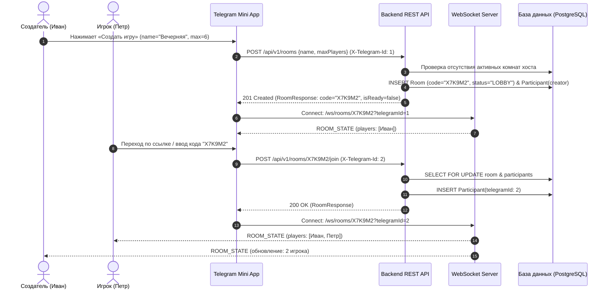
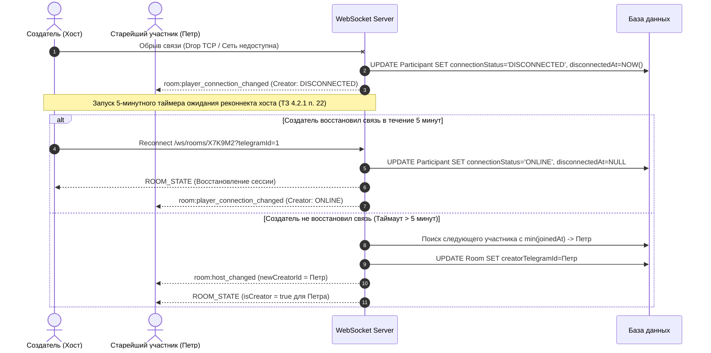
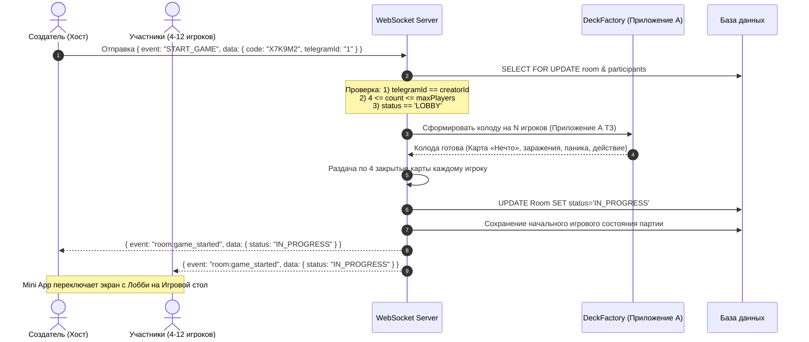

# Спецификация контрактов сетевого взаимодействия лобби и игровых комнат (PO-4)

| Параметр | Значение |
| :--- | :--- |
| **Документ** | Спецификация протокола сетевого обмена (REST DTO и WebSocket Events) |
| **Модуль** | Управление игровыми комнатами и лобби ожидания (`lobby-room-module`) |
| **Версия спецификации** | 1.0.0 |
| **Статус** | Согласовано / Архитектурный контракт команды |
| **Нормативная база** | **ТЗ раздел 4.1.1.2** («Требования к организации обмена информацией между компонентами Системы»), **ТЗ раздел 4.2.1** («Управление игровой комнатой»), **ТЗ раздел 4.3** («Обработка ошибок») |
| **Связанные задачи** | PO-4, PO-5, BE-2, BE-3, BE-4, BE-5, BE-6, FE-2, FE-3, FE-5, FE-6 |

---

## 1. Введение и базовые принципы

### 1.1. Назначение документа
Настоящая спецификация определяет единый, обязательный к соблюдению контракт сетевого взаимодействия между клиентской частью (**Frontend / Telegram Mini App**) и серверной частью (**Backend на Java / Spring Boot**) многопользовательской карточной игры **«Нечто» (Stay Away!)**.

Документ фиксирует:
1. Форматы входных и выходных DTO эндпоинта создания комнаты `POST /api/rooms` (и его канонического алиаса `/api/v1/rooms`).
2. Семантику, схемы и правила передачи клиентских WebSocket-событий `JOIN_ROOM`, `LEAVE_ROOM`, `START_GAME`.
3. Схему и структуру широковещательного события актуального состояния комнаты `ROOM_STATE` (и связанных дельта-событий).
4. Единый формат ответов об ошибках и исчерпывающий каталог кодов ошибок.

### 1.2. Нормативные требования ТЗ (Трассировка)
- **ТЗ 4.1.1.2:** Сетевой обмен между клиентом и сервером выполняется исключительно по защищённым протоколам **HTTPS** (REST API) и **WSS** (WebSocket) с сериализацией полезной нагрузки в формате **JSON** (кодировка **UTF-8**). Клиент передаёт намерение/действие, сервер выполняет строгую доменную валидацию и возвращает подтверждённое состояние. Скрытые игровые данные не должны передаваться неавторизованным участникам.
- **ТЗ 4.2.1:** Сервер генерирует уникальный идентификатор комнаты (UUID), короткий код приглашения (4–12 символов, на практике — 6 символов алфавита без омоглифов `[A-Z0-9]`) и ссылку-приглашение в Telegram Mini App. Число участников партии строго ограничено диапазоном **от 4 до 12**. Создатель комнаты наделяется исключительными правами настройки и запуска. Обеспечивается идемпотентность подключений по Telegram ID, защита от дублирования сессий, обработка разрывов связи и передача роли хоста при выходе создателя.
- **ТЗ 4.3:** Все ошибки типизируются, имеют стандартизированную структуру и не раскрывают клиенту чувствительные данные инфраструктуры или закрытую игровую информацию.

---

## 2. Аутентификация и идентификация пользователей Telegram

В соответствии с требованиями интеграции Telegram Mini App идентификация пользователя выполняется по данным Telegram WebApp.

### 2.1. Идентификация в REST API
При выполнении HTTP-запросов клиент обязан передавать контекст игрока в HTTP-заголовках:

| HTTP Заголовок | Тип данных | Обязательность | Описание и валидация |
| :--- | :--- | :--- | :--- |
| `X-Telegram-Id` | `String` / `Long` | **Да\*** | Уникальный цифровой ID пользователя Telegram (например, `"123456789"`). |
| `X-Telegram-Username` | `String` | Нет | Никнейм пользователя Telegram (например, `"ivan_ivanov"`). |
| `X-Telegram-Display-Name` | `String` | Нет | Отображаемое имя игрока (1–64 символа, санитизируется от HTML/JS инъекций). |

*\* Примечание: Для сценариев локального тестирования или резервной интеграции допускается передача `telegramId`, `username`, `displayName` непосредственно в JSON-теле запроса (fallback). При отсутствии идентификатора и в заголовке, и в теле сервер возвращает `401 Unauthorized` (`UNAUTHORIZED`).*

### 2.2. Идентификация в WebSocket
Идентификационные параметры передаются при установлении WebSocket-соединения (Handshake) в строке запроса Query Parameters:
```
ws://localhost:8080/ws/rooms/{code}?telegramId={telegramId}&displayName={displayName}&username={username}
```
Либо при отправке первого сообщения подписки на общую точку подключения (`/ws`).

---

## 3. Спецификация REST DTO

### 3.1. Создание игровой комнаты: `POST /api/rooms` (алиас `/api/v1/rooms`)
Позволяет авторизованному пользователю Telegram создать новую игровую комнату и стать её первым участником (хостом/создателем).

- **HTTP Метод:** `POST`
- **Пути:** `/api/v1/rooms` (основной), `/api/rooms` (алиас обратной совместимости)
- **Content-Type:** `application/json; charset=utf-8`

#### 3.1.1. Тело запроса (`CreateRoomRequest` DTO)

```json
{
  "name": "Вечерняя партия",
  "maxPlayers": 8,
  "telegramId": "123456789",
  "username": "ivan_ivanov",
  "displayName": "Иван"
}
```

##### Спецификация полей `CreateRoomRequest`:
| Поле | Тип | Обязательность | Ограничения валидации (ТЗ 4.2.1) | Описание |
| :--- | :--- | :--- | :--- | :--- |
| `name` | `String` | **Да** | Длина от 1 до 32 символов включительно. Не должно быть пустым или состоять только из пробелов. | Название создаваемой комнаты |
| `maxPlayers` | `Integer` | **Да** | Диапазон от **4** до **12** включительно. Значение по умолчанию: `8`. | Лимит количества участников в комнате |
| `telegramId` | `String` | Опционально\* | Цифровая строка Telegram ID. | Fallback, если не передан заголовок `X-Telegram-Id` |
| `username` | `String` | Опционально | До 64 символов. | Fallback для Telegram Username |
| `displayName` | `String` | Опционально | От 1 до 64 символов, без тегов разметки `<` `>`. | Fallback для отображаемого имени |

#### 3.1.2. Успешный ответ `201 Created` (`RoomResponse` DTO)

```json
{
  "id": "e4eaaaf2-d142-11e1-b3e4-080027620cdd",
  "code": "X7K9M2",
  "inviteLink": "https://t.me/StayAwayGameBot/app?startapp=X7K9M2",
  "name": "Вечерняя партия",
  "creatorId": "123456789",
  "status": "LOBBY",
  "maxPlayers": 8,
  "currentPlayersCount": 1,
  "isReadyToStart": false,
  "players": [
    {
      "telegramId": "123456789",
      "username": "ivan_ivanov",
      "displayName": "Иван",
      "isCreator": true,
      "connectionStatus": "ONLINE",
      "joinedAt": "2026-11-09T12:00:00.000Z",
      "disconnectedAt": null
    }
  ],
  "createdAt": "2026-11-09T12:00:00.000Z"
}
```

##### Спецификация полей `RoomResponse`:
| Поле | Тип | Описание |
| :--- | :--- | :--- |
| `id` | `UUID` | Внутренний уникальный идентификатор сущности комнаты |
| `code` | `String` | Уникальный код входа из 6 символов `[A-Z0-9]` для ввода вручную |
| `inviteLink` | `String` | Прямая ссылка-приглашение Telegram вида `https://t.me/<bot>/app?startapp=<CODE>` |
| `name` | `String` | Название игровой комнаты |
| `creatorId` | `String` | Telegram ID создателя (текущего хоста комнаты) |
| `status` | `String` (Enum) | Состояние комнаты: `LOBBY`, `IN_PROGRESS`, `FINISHED`, `ARCHIVED` |
| `maxPlayers` | `Integer` | Максимальное количество игроков (4–12) |
| `currentPlayersCount`| `Integer` | Текущее количество зарегистрированных игроков |
| `isReadyToStart` | `Boolean` | Флаг готовности к старту (`true`, если `currentPlayersCount >= 4 && currentPlayersCount <= maxPlayers`) |
| `players` | `Array<RoomParticipant>` | Список всех участников комнаты (структура описана ниже) |
| `createdAt` | `String` (ISO-8601) | Точное время создания комнаты по UTC |

##### Структура элемента `RoomParticipant`:
| Поле | Тип | Описание |
| :--- | :--- | :--- |
| `telegramId` | `String` | Уникальный цифровой идентификатор игрока в Telegram |
| `username` | `String \| null` | Никнейм Telegram (без символа `@`) |
| `displayName` | `String` | Отображаемое имя участника в интерфейсе |
| `isCreator` | `Boolean` | Флаг прав создателя/хоста комнаты |
| `connectionStatus` | `String` (Enum) | Статус сетевого соединения: `ONLINE` или `DISCONNECTED` |
| `joinedAt` | `String` (ISO-8601) | Метка времени первого входа в комнату (используется для очереди прав хоста) |
| `disconnectedAt` | `String \| null` | Метка времени потери связи (для отсчета 5-минутного таймаута по ТЗ 4.2.1) |

#### 3.1.3. Ошибки при создании комнаты
- `400 Bad Request` (`VALIDATION_ERROR`, `INVALID_PLAYER_NAME`) — невалидное имя комнаты или превышение лимитов игроков.
- `401 Unauthorized` (`UNAUTHORIZED`) — не переданы идентификаторы Telegram.
- `409 Conflict` (`ACTIVE_ROOM_ALREADY_EXISTS`) — у пользователя уже есть активная созданная им комната (ТЗ 4.2.1).

---

### 3.2. Дополнительные вспомогательные REST-эндпоинты лобби

| Метод и URL | Назначение | Коды ответов |
| :--- | :--- | :--- |
| `GET /api/v1/rooms/{code}` | Получение текущего состояния комнаты по коду. Регистронезависимо. | `200 OK` (`RoomResponse`), `400 INVALID_ROOM_CODE`, `404 ROOM_NOT_FOUND` |
| `POST /api/v1/rooms/{code}/join` | Подключение игрока к комнате по коду. **Идемпотентно**: повторный вызов восстанавливает `ONLINE` статус и возвращает `200 OK`. При 4 игроках выставляет `isReadyToStart = true`. | `200 OK` (`RoomResponse`), `400 INVALID_PLAYER_NAME`, `404 ROOM_NOT_FOUND`, `409 ROOM_FULL`, `409 ROOM_ALREADY_STARTED` |
| `POST /api/v1/rooms/{code}/leave`| Выход участника из комнаты. При выходе создателя права хоста передаются следующему участнику с минимальным `joinedAt`. Если комната опустела — удаляется. | `200 OK` (`RoomResponse`), `404 ROOM_NOT_FOUND` |
| `PATCH /api/v1/rooms/{code}/settings`| Изменение лимита игроков `maxPlayers`. Доступно только текущему создателю (`creatorId`). Значение не может быть меньше текущего количества подключённых игроков. | `200 OK` (`RoomResponse`), `400 INVALID_MAX_PLAYERS`, `403 FORBIDDEN_NOT_CREATOR`, `409 ROOM_ALREADY_STARTED` |

---

## 4. Спецификация WebSocket-протокола

### 4.1. Транспорт и структура сообщения (Message Envelope)
В соответствии с ТЗ 4.1.1.2 сетевое взаимодействие реального времени осуществляется по протоколу WSS/WS. Все сообщения, отправляемые клиентом и сервером, заворачиваются в единый стандартизированный JSON-конверт:

```json
{
  "event": "<EVENT_NAME>",
  "timestamp": "2026-11-09T12:00:00.000Z",
  "data": { ... }
}
```

- `event` (`String`, обязательное) — строковый идентификатор типа события в верхнем регистре (или пространстве имён `room:`).
- `timestamp` (`String`, ISO-8601 UTC) — метка времени формирования события сервером.
- `data` (`Object`, обязательное) — полезная нагрузка (payload) события.

### 4.2. Механизм Keep-Alive (Heartbeat)
Для предотвращения закрытия сессии промежуточными прокси-серверами и проверки активности:
- Клиент каждые 25 секунд отправляет:
  ```json
  { "event": "ping" }
  ```
- Сервер незамедлительно отвечает:
  ```json
  { "event": "pong" }
  ```

---

### 4.3. Клиентские события WebSocket (Client-to-Server)

#### 4.3.1. Событие `JOIN_ROOM`
Отправляется клиентом для входа в игровую комнату и подписки на её обновления через активное WebSocket-соединение.

##### Формат пакета:
```json
{
  "event": "JOIN_ROOM",
  "data": {
    "code": "X7K9M2",
    "telegramId": "987654321",
    "username": "petr_petrov",
    "displayName": "Петр"
  }
}
```

##### Бизнес-правила обработки (ТЗ 4.2.1):
1. **Проверка существования:** Если комната с кодом `code` не найдена — сервер возвращает ошибку `ROOM_NOT_FOUND`.
2. **Идемпотентность и восстановление:** Если игрок с указанным `telegramId` уже числится в комнате, сервер переводит его статус в `ONLINE`, сбрасывает таймер `disconnectedAt = null` и регистрирует текущую WebSocket-сессию.
3. **Проверка статуса комнаты:** Если статус комнаты не равен `LOBBY` (партия уже началась) — возвращается ошибка `ROOM_ALREADY_STARTED`.
4. **Проверка вместимости:** Если число участников достигло `maxPlayers` — сервер отклоняет вход с ошибкой `ROOM_FULL`.
5. **Реакция сервера:** 
   - Клиенту отправляется персональное событие `ROOM_STATE` (синхронизация снапшота).
   - Всем остальным участникам комнаты рассылается широковещательное обновление `ROOM_STATE` (или дельта `room:player_joined`).

---

#### 4.3.2. Событие `LEAVE_ROOM`
Отправляется клиентом при явном выходе игрока из комнаты (например, нажатие кнопки «Покинуть лобби»).

##### Формат пакета:
```json
{
  "event": "LEAVE_ROOM",
  "data": {
    "code": "X7K9M2",
    "telegramId": "987654321"
  }
}
```

##### Бизнес-правила обработки (ТЗ 4.2.1, п. 19-20):
1. Участник удаляется из списка `players` комнаты, счетчик `currentPlayersCount` уменьшается на 1.
2. Проверяется готовность к старту: если `currentPlayersCount < 4`, флаг `isReadyToStart` переводится в `false`.
3. **Передача прав хоста:** Если комнату покинул создатель (`isCreator = true`), сервер автоматически находит оставшегося участника с самым ранним временем подключения (`min(joinedAt)`) и назначает его новым хостом (`isCreator = true`, обновление `creatorId`).
4. **Удаление пустой комнаты:** Если в комнате в статусе `LOBBY` не осталось ни одного участника, комната немедленно удаляется из базы данных.
5. **Реакция сервера:** Всем оставшимся участникам рассылается широковещательное событие `ROOM_STATE` (или дельта `room:player_left` и `room:host_changed`).

---

#### 4.3.3. Событие `START_GAME`
Отправляется создателем комнаты для завершения этапа лобби и старта игровой партии.

##### Формат пакета:
```json
{
  "event": "START_GAME",
  "data": {
    "code": "X7K9M2",
    "telegramId": "123456789"
  }
}
```

##### Бизнес-правила обработки (ТЗ 4.2.1 п. 14–17, ТЗ 4.2.2):
1. **Проверка прав:** Сервер проверяет, что `telegramId` инициатора совпадает с текущим `creatorId` комнаты. Если нет — возвращается ошибка `FORBIDDEN_NOT_CREATOR`.
2. **Проверка статуса:** Статус комнаты обязан быть `LOBBY`. При любом другом статусе — ошибка `ROOM_ALREADY_STARTED`.
3. **Проверка количества участников:** Количество участников должно удовлетворять условию:
   $$\text{MIN\_PLAYERS} \le \text{currentPlayersCount} \le \text{maxPlayers}$$
   где $\text{MIN\_PLAYERS} = 4$. Если игроков менее 4 — возвращается ошибка `NOT_ENOUGH_PLAYERS`.
4. **Фиксация колоды и состояния:**
   - Вызывается доменная фабрика колоды (`DeckFactory`) в соответствии с Приложением А ТЗ.
   - Включается одна уникальная карта «Нечто», требуемое количество карт «Заражение!» и карт паники/действий.
   - Начальный набор карт (включая «Нечто») перемешивается и каждому игроку раздаётся ровно по 4 карты в руку.
   - Статус комнаты меняется на `IN_PROGRESS`.
   - Запрещается дальнейшее подключение новых игроков и изменение состава колоды.
5. **Реакция сервера:** 
   - Рассылается широковещательное событие смены статуса `GAME_STARTED` (или `ROOM_STATE` с новым статусом `IN_PROGRESS`).
   - Инициализируется игровой цикл партии.

---

### 4.4. Серверные события WebSocket (Server-to-Client Broadcast)

#### 4.4.1. Широковещательное событие `ROOM_STATE` (Состояние комнаты)
Является фундаментальным событием синхронизации лобби. Рассылается сервером:
- Новому или переподключившемуся игроку в момент установки сессии (Initial State Sync);
- Всем игрокам комнаты при любом изменении состава участников или параметров лобби;
- При переподключении клиента для разрешения конфликтов состояния (State Reconciliation).

##### Пример пакета `ROOM_STATE`:
```json
{
  "event": "ROOM_STATE",
  "timestamp": "2026-11-09T12:02:15.120Z",
  "data": {
    "id": "e4eaaaf2-d142-11e1-b3e4-080027620cdd",
    "code": "X7K9M2",
    "inviteLink": "https://t.me/StayAwayGameBot/app?startapp=X7K9M2",
    "name": "Вечерняя партия",
    "creatorId": "123456789",
    "status": "LOBBY",
    "maxPlayers": 8,
    "currentPlayersCount": 4,
    "isReadyToStart": true,
    "players": [
      {
        "telegramId": "123456789",
        "username": "ivan_ivanov",
        "displayName": "Иван",
        "isCreator": true,
        "connectionStatus": "ONLINE",
        "joinedAt": "2026-11-09T12:00:00.000Z",
        "disconnectedAt": null
      },
      {
        "telegramId": "987654321",
        "username": "petr_petrov",
        "displayName": "Петр",
        "isCreator": false,
        "connectionStatus": "ONLINE",
        "joinedAt": "2026-11-09T12:01:10.000Z",
        "disconnectedAt": null
      },
      {
        "telegramId": "555444333",
        "username": "olga_s",
        "displayName": "Ольга",
        "isCreator": false,
        "connectionStatus": "ONLINE",
        "joinedAt": "2026-11-09T12:01:45.000Z",
        "disconnectedAt": null
      },
      {
        "telegramId": "777888999",
        "username": "alex_k",
        "displayName": "Алексей",
        "isCreator": false,
        "connectionStatus": "ONLINE",
        "joinedAt": "2026-11-09T12:02:15.000Z",
        "disconnectedAt": null
      }
    ],
    "createdAt": "2026-11-09T12:00:00.000Z"
  }
}
```

##### Гранулярные дельта-события реализации (Fine-grained Events)
Для оптимизации сетевого трафика и точечной анимации в React-интерфейсе сервер поддерживает отправку гранулярных дельта-событий (обрабатываемых клиентским `roomEventReducer`):

| Событие | Назначение | Содержимое `data` |
| :--- | :--- | :--- |
| `room:state_sync` | Полная синхронизация состояния при подключении. | Полный объект `RoomResponse` (эквивалентно `ROOM_STATE`). |
| `room:player_joined` | Уведомление о входе нового игрока. | `{ "joinedPlayer": RoomParticipant, "room": RoomSnapshotPatch }` |
| `room:player_left` | Уведомление о выходе игрока. | `{ "leftPlayerId": string, "newCreatorId": string \| null, "room": RoomSnapshotPatch }` |
| `room:host_changed` | Смена создателя комнаты. | `{ "previousCreatorId": string, "newCreatorId": string, "players": RoomParticipant[] }` |
| `room:settings_updated` | Изменение лимита `maxPlayers`. | `{ "maxPlayers": number, "isReadyToStart": boolean, "room": RoomSnapshotPatch }` |
| `room:player_connection_changed` | Смена статуса соединения (`ONLINE` / `DISCONNECTED`). | `{ "telegramId": string, "connectionStatus": "ONLINE" \| "DISCONNECTED" }` |
| `room:game_started` | Старт игры по событию `START_GAME`. | `{ "status": "IN_PROGRESS", "roomCode": string }` |

---

## 5. Унифицированная обработка и коды ошибок

### 5.1. Структура payload'а ошибки
В соответствии с разделом 4.3 ТЗ все ошибки (как HTTP, так и переданные через WebSocket-событие `ERROR`) имеют унифицированную структуру.

#### Формат ответа об ошибке в REST:
```json
{
  "timestamp": "2026-11-09T12:15:30.123Z",
  "status": 409,
  "path": "/api/v1/rooms/X7K9M2/join",
  "error": {
    "code": "ROOM_FULL",
    "message": "Комната заполнена",
    "details": []
  }
}
```

#### Формат ошибки валидации (`400 Bad Request` / `VALIDATION_ERROR`):
```json
{
  "timestamp": "2026-11-09T12:16:00.000Z",
  "status": 400,
  "path": "/api/v1/rooms",
  "error": {
    "code": "VALIDATION_ERROR",
    "message": "Ошибка валидации входных параметров",
    "details": [
      {
        "field": "name",
        "issue": "Название комнаты должно содержать от 1 до 32 символов"
      },
      {
        "field": "maxPlayers",
        "issue": "Количество участников должно быть в диапазоне от 4 до 12"
      }
    ]
  }
}
```

#### Формат события ошибки в WebSocket (`ERROR`):
```json
{
  "event": "ERROR",
  "timestamp": "2026-11-09T12:16:00.000Z",
  "data": {
    "code": "NOT_ENOUGH_PLAYERS",
    "message": "Для начала игры необходимо минимум 4 участника",
    "details": []
  }
}
```

---

### 5.2. Каталог кодов ошибок (Error Code Catalog)

| HTTP Статус | Код ошибки (`code`) | Область возникновения | Локализованное сообщение пользователю | Описание и триггер |
| :--- | :--- | :--- | :--- | :--- |
| `400` | `VALIDATION_ERROR` | REST / WS | Ошибка валидации входных параметров | Некорректные параметры запроса (`name`, `maxPlayers` вне 4..12) |
| `400` | `INVALID_ROOM_CODE` | REST / WS | Неверный формат кода комнаты | Код не соответствует регулярному выражению `^[A-Z0-9]{4,12}$` |
| `400` | `INVALID_PLAYER_NAME` | REST / WS | Недопустимое имя игрока | Имя пустое, > 64 символов или содержит опасные символы/HTML |
| `400` | `INVALID_MAX_PLAYERS` | REST / WS | Недопустимый лимит участников | Попытка установить `maxPlayers` меньше текущего числа игроков в комнате |
| `401` | `UNAUTHORIZED` | REST / WS | Пользователь не идентифицирован | Отсутствует `X-Telegram-Id` и данные Telegram в теле запроса |
| `403` | `FORBIDDEN_NOT_CREATOR` | REST / WS | Действие доступно только создателю комнаты | Вызов `START_GAME` или `PATCH /settings` игроком, не являющимся хостом |
| `404` | `ROOM_NOT_FOUND` | REST / WS | Комната не найдена или была удалена | Комната с данным кодом не найдена в базе данных |
| `409` | `ROOM_FULL` | REST / WS | Комната заполнена | В комнате достигнут лимит игроков (`currentPlayersCount >= maxPlayers`) |
| `409` | `ROOM_ALREADY_STARTED` | REST / WS | Партия уже началась | Попытка подключения к комнате в статусе `IN_PROGRESS` или `FINISHED` |
| `409` | `ACTIVE_ROOM_ALREADY_EXISTS` | REST | У вас уже есть активная созданная комната | Пользователь пытается создать вторую комнату, не завершив предыдущую |
| `409` | `NOT_ENOUGH_PLAYERS` | REST / WS | Недостаточно участников для старта партии | Попытка вызова `START_GAME` при количестве участников < 4 |
| `500` | `INTERNAL_SERVER_ERROR` | REST / WS | Внутренняя ошибка сервера | Необработанное исключение. Все детали SQL и стектрейсы маскируются |

---

## 6. Диаграммы последовательности взаимодействия (Sequence Diagrams)

### 6.1. Создание комнаты, подключение участников и синхронизация состояния



---

### 6.2. Потеря соединения, 5-минутный таймаут и передача прав хоста (ТЗ 4.2.1 п. 20–23)



---

### 6.3. Запуск партии хостом (`START_GAME`)



---

## 7. Чек-лист готовности и приёмка контракта (Definition of Done)

- [x] Согласован точный формат DTO запроса и ответа для `POST /api/rooms` и `POST /api/v1/rooms`.
- [x] Описаны структуры и сценарии всех клиентских WebSocket-событий: `JOIN_ROOM`, `LEAVE_ROOM`, `START_GAME`.
- [x] Описана исчерпывающая схема широковещательного события `ROOM_STATE` и дельта-событий синхронизации.
- [x] Зафиксирован единый формат payload'а ошибок и составлен исчерпывающий каталог кодов ошибок с HTTP-маппингом.
- [x] Приведены Sequence-диаграммы всех жизненных циклов лобби (подключение, дисконнект с таймаутом 5 минут, старт партии).
- [x] Обеспечена 100% трассируемость к требованиям ТЗ (разделы 4.1.1.2, 4.2.1, 4.3).
