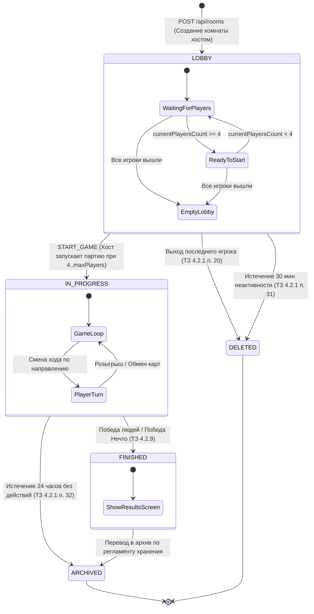
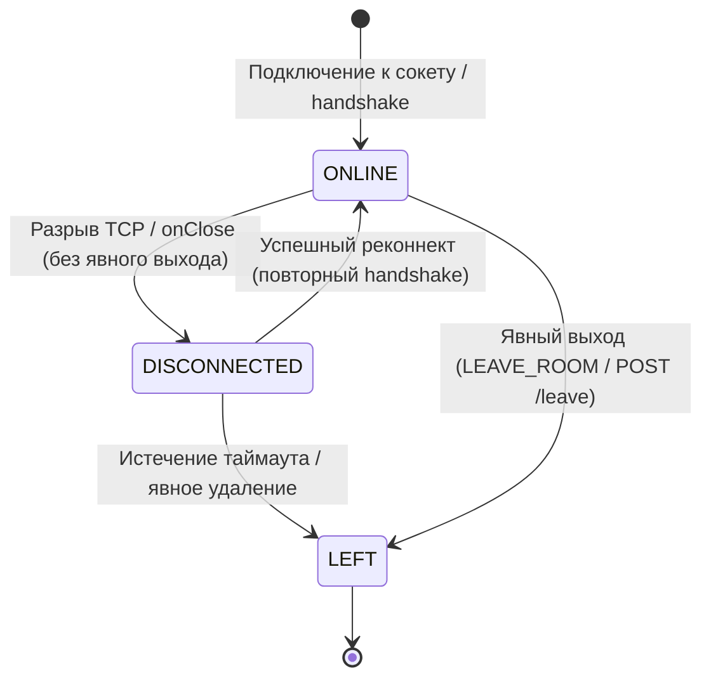
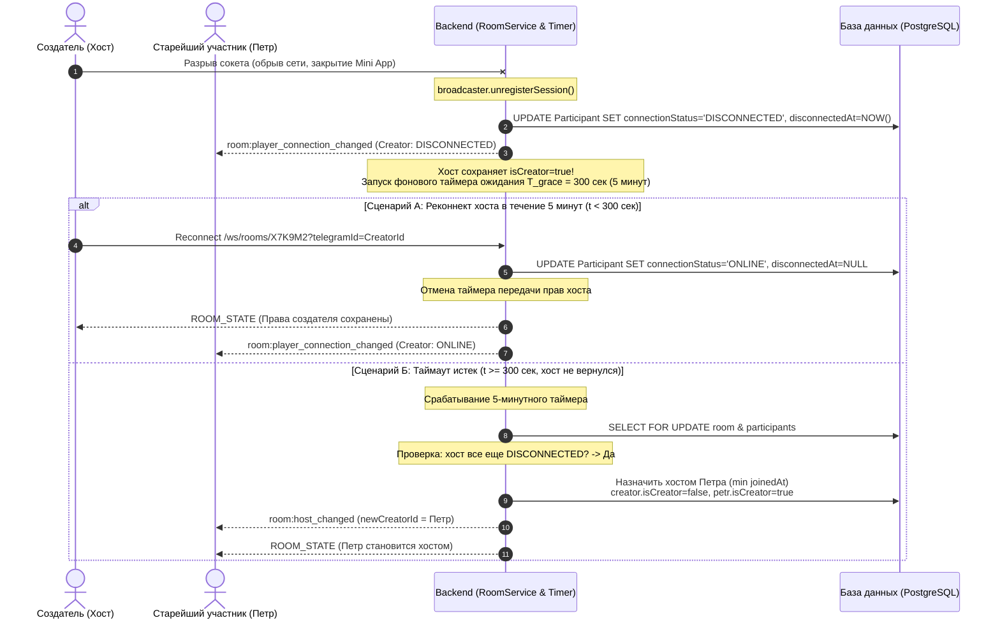
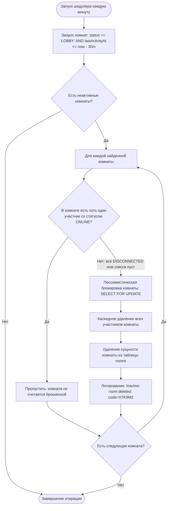

# Архитектурная спецификация состояний комнат (State Machine), таймаутов и сценариев реконнекта (PO-5)

| Параметр | Значение |
| :--- | :--- |
| **Документ** | Спецификация жизненного цикла комнаты, конечного автомата, таймаутов и реконнекта |
| **Модуль** | Управление жизненным циклом комнат и сессий участников (`room-lifecycle-engine`) |
| **Версия спецификации** | 1.0.0 |
| **Статус** | Согласовано / Архитектурный стандарт команды |
| **Нормативная база** | **ТЗ раздел 4.1.1.4** («Требования к режимам функционирования Системы»), **ТЗ раздел 4.1.2.2** («Степень надежности»), **ТЗ раздел 4.2.1** («Управление игровой комнатой»), **ТЗ раздел 4.3** («Обработка ошибок») |
| **Связанные задачи** | PO-4, PO-5, BE-2, BE-3, BE-5, BE-6, FE-2, FE-3, FE-5, FE-6 |

---

## 1. Введение и область применения

Настоящий документ формализует жизненный цикл игровых комнат, конечные автоматы состояний комнат и участников, регламенты обработки сетевых таймаутов (5 минут и 30 минут), алгоритмы миграции прав создателя (хоста) и сценарии восстановления соединения (реконнекта) в многопользовательской карточной игре **«Нечто» (Stay Away!)**.

Спецификация является обязательным архитектурным ориентиром для реализации серверной бизнес-логики (`apps/backend`, задачи BE-5, BE-6) и клиентского управления состоянием интерфейса (`apps/frontend`, задачи FE-5, FE-6).

---

## 2. Конечный автомат жизненного цикла комнаты (Room State Machine)

### 2.1. Перечень состояний комнаты
Комната в базе данных и оперативной памяти сервера всегда находится ровно в одном из следующих фиксированных состояний:

| Состояние | Обозначение в коде | Семантика в ТЗ | Описание |
| :--- | :--- | :--- | :--- |
| **Лобби ожидания** | `LOBBY` | Режим лобби и настройки партии (ТЗ 4.1.1.4, ТЗ 4.2.1 п. 4) | Комната создана. Игроки могут подключаться по коду/ссылке, выходить, менять готовность. Создатель может настраивать лимит `maxPlayers` (4–12) и инициировать старт при наличии $\ge 4$ игроков. |
| **Активная партия** | `IN_PROGRESS` *(в нотации ТЗ: `IN_GAME`)* | Режим активной игры и хода (ТЗ 4.1.1.4, ТЗ 4.2.1 п. 14–17) | Партия запущена создателем. Состав игроков и колода зафиксированы. **Вход новых игроков и изменение настроек строго запрещены**. Выполняется игровой процесс. |
| **Партия завершена** | `FINISHED` | Режим завершения и просмотра результатов (ТЗ 4.1.1.4) | Выполнены условия окончания партии (победа Нечто или победа людей). Игровой цикл остановлен. Игрокам отображается итоговый экран со статистикой и раскрытыми ролями. |
| **Архивирована** | `ARCHIVED` | Архивное хранение (ТЗ 4.2.1 п. 32) | Партия не была завершена в течение 24 часов после последнего хода, либо завершённая комната переведена в архив. Изменение состояния запрещено. |
| **Удалена** | `DELETED` | Физическое удаление записи (ТЗ 4.2.1 п. 20, 31) | Комната полностью удалена из базы данных (все участники вышли из лобби, либо сработал 30-минутный таймер неактивности). |

---

### 2.2. Диаграмма состояний комнаты (Mermaid State Diagram)



---

### 2.3. Матрица переходов состояний комнаты (State Transition Table)

| Исходное состояние | Событие / Триггер | Ограничивающее условие (Guard) | Выполняемое действие (Action) | Новое состояние |
| :--- | :--- | :--- | :--- | :--- |
| `[*]` | Вызов `POST /api/rooms` | У создателя нет других активных комнат; `name` 1–32 символа; `maxPlayers` $\in [4, 12]$ | Генерация уникального кода `code` (6 символов) и UUID; создание хоста; `currentPlayersCount = 1`; `isReadyToStart = false` | `LOBBY` |
| `LOBBY` | Вход игрока (`JOIN_ROOM`) | `currentPlayersCount < maxPlayers`; комната не закрыта | Добавление игрока в список `players`; `currentPlayersCount++`; если `count >= 4` $\to$ `isReadyToStart = true`; рассылка `ROOM_STATE` | `LOBBY` |
| `LOBBY` | Выход игрока (`LEAVE_ROOM`) | Игрок не является последним участником | Удаление игрока; `currentPlayersCount--`; если вышел хост $\to$ миграция хоста к `min(joinedAt)`; если `count < 4` $\to$ `isReadyToStart = false`; рассылка `ROOM_STATE` | `LOBBY` |
| `LOBBY` | Выход последнего игрока | `players.size() == 1` | Удаление сущности комнаты из хранилища | `DELETED` |
| `LOBBY` | Таймер неактивности (30 мин) | `now - lastActivityAt >= 30m` $\land$ нет онлайн-игроков | Каскадное удаление участников и комнаты шедулером | `DELETED` |
| `LOBBY` | Вызов `START_GAME` | Инициатор == `creatorId`; `currentPlayersCount` $\in [4, maxPlayers]$ | Проверка состава колоды; формирование колоды через `DeckFactory` (Приложение А ТЗ); раздача по 4 карты; фиксация колоды; рассылка `room:game_started` | `IN_PROGRESS` |
| `IN_PROGRESS` | Попытка входа нового игрока | Любой игрок, отсутствующий в `players` | Отклонение запроса с ошибкой `409 ROOM_ALREADY_STARTED` | `IN_PROGRESS` |
| `IN_PROGRESS` | Условие победы (ТЗ 4.2.9) | Нечто сожжено $\lor$ Все выжившие заражены $\lor$ Нечто выжило | Остановка игрового таймера; расчет победителей; рассылка события окончания партии с открытием ролей | `FINISHED` |
| `IN_PROGRESS` | Таймер хранения (24 часа) | `now - lastActionAt >= 24h` | Блокировка ходов; перевод партии в архивную таблицу | `ARCHIVED` |
| `FINISHED` | Истечение времени показа итогов | Сессия завершена | Закрытие WebSocket-комнаты; архивирование записи | `ARCHIVED` |

---

## 3. Конечный автомат сетевого статуса участника (Participant State Machine)

Каждый участник комнаты (`RoomParticipant`) обладает собственным жизненным циклом сетевого присутствия:



### Спецификация сетевых статусов участника:
1. **`ONLINE`:**
   - Участник имеет активную зарегистрированную сессию WebSocket.
   - Поле `disconnectedAt = null`.
   - Сервер регулярно получает и подтверждает `ping`/`pong`.
2. **`DISCONNECTED`:**
   - Сокет участника закрыт или оборван, но участник не покидал комнату явно через кнопку интерфейса.
   - Сервер фиксирует точное время обрыва: `disconnectedAt = Instant.now()`.
   - В лобби запускается защитный таймер (Grace Period).
   - В интерфейсе остальных игроков аватар/имя участника маркируется индикатором «Оффлайн / Переподключение».
3. **`LEFT`:**
   - Участник явно нажал кнопку выхода или был исключён по таймауту.
   - Участник удаляется из списка `players` комнаты.

---

## 4. Алгоритм передачи прав хоста по `joinedAt` (`connectedAt`)

В соответствии с **ТЗ 4.2.1, п. 20–21**, при выходе создателя из лобби до начала партии права управления комнатой автоматически передаются участнику, подключившемуся к комнате раньше остальных оставшихся участников.

### 4.1. Формальный алгоритм миграции хоста
Пусть $P = \{p_1, p_2, \dots, p_n\}$ — упорядоченное множество оставшихся участников комнаты.
Для каждого участника $p_i$ зафиксировано неизменяемое время первого входа $p_i.\text{joinedAt}$ (`Instant` по UTC).

При наступлении события миграции сервер выполняет:
1. Проверка наличия оставшихся участников:
   $$\text{Если } |P| == 0 \implies \text{Удалить комнату (DELETED); Завершить.}$$
2. Выбор кандидата на роль нового хоста с наименьшим временем подключения:
   $$p_{new} = \arg\min_{p \in P} (p.\text{joinedAt})$$
   *(В случае совпадения меток времени до миллисекунд детерминированным тай-брейкером выступает лексикографический порядок `telegramId`).*
3. Обновление сущностей в единой транзакции базы данных:
   - Снятие флага со старого хоста: $p_{old}.\text{isCreator} = \text{false}$.
   - Назначение нового хоста: $p_{new}.\text{isCreator} = \text{true}$.
   - Обновление идентификатора в комнате: $\text{room}.\text{creatorId} = p_{new}.\text{telegramId}$.
   - Обновление меток времени: $\text{room}.\text{updatedAt} = \text{now}$, $\text{room}.\text{lastActivityAt} = \text{now}$.
4. Рассылка WebSocket-событий участникам:
   - Сервер формирует и рассылает событие `room:host_changed`:
     ```json
     {
       "event": "room:host_changed",
       "timestamp": "2026-11-09T12:05:00.000Z",
       "data": {
         "previousCreatorId": "123456789",
         "newCreatorId": "987654321",
         "players": [ ... ]
       }
     }
     ```
   - Рассылается обновлённый снимок состояния `ROOM_STATE`.
5. Клиентский интерфейс Telegram Mini App:
   - У пользователя с `telegramId == newCreatorId` активируются элементы управления:
     - Кнопки изменения лимита участников `maxPlayers` (компонент `PlayerCountStepper`);
     - Кнопка запуска партии «Начать игру» (при `isReadyToStart == true`).

### 4.2. Инвариант хоста
> **Архитектурный инвариант:** В любой непустой комнате в любой момент времени существует **ровно один** активный создатель/хост:
> $$\sum_{p \in players} [p.\text{isCreator} == \text{true}] \equiv 1$$

---

## 5. Спецификация 5-минутного таймера удержания хоста при дисконнекте

В соответствии с **ТЗ 4.2.1, п. 22–23**:
- При временной потере соединения создателя, если он не покинул комнату явно, за ним **сохраняются права управления в течение 5 минут** (300 секунд).
- Если создатель не восстановил соединение в течение 5 минут, права управления передаются следующему участнику в порядке времени подключения.

### 5.1. Назначение и обоснование
В условиях мобильной сети Telegram Mini App (проезд в тоннеле, лифт, переключение между Wi-Fi и LTE) разрывы WebSocket-соединений происходят регулярно. Если бы права хоста передавались мгновенно при обрыве TCP-сокета, создатель терял бы управление комнатой из-за секундного сбоя связи. 5-минутный Grace Period устраняет эту проблему.

### 5.2. Пошаговая логика обработки дисконнекта хоста



### 5.3. Правила отмены и пограничные случаи:
1. **Досрочная отмена таймера:** Если создатель успешно восстанавливает WebSocket-сессию до истечения 300 секунд, таймер аннулируется, статус переводится в `ONLINE`, права сохраняются.
2. **Явный выход создателя:** Если создатель нажал «Выйти из комнаты» (вызов `POST /leave` или `LEAVE_ROOM`), 5-минутный таймер **не запускается** — права передаются немедленно.
3. **Старт игры во время ожидания:** Другие игроки не могут начать игру, пока создатель находится во временном дисконнекте, так как права хоста остаются за ним до истечения 5 минут.

---

## 6. Спецификация 30-минутного таймера очистки неактивных комнат

В соответствии с **ТЗ 4.2.1, п. 31**, система обязана удалять комнату, в которой партия ещё не началась, через **30 минут после последней активности при отсутствии активных пользователей**.

### 6.1. Назначение таймера
- Предотвращение утечки оперативной памяти и дискового пространства базы данных от «заброшенных» лобби.
- Освобождение коротких кодов комнат (6-значный алфавит без омоглифов `[A-Z0-9]`) для повторного использования новыми игроками.

### 6.2. Определение метки последней активности (`lastActivityAt`)
Поле `lastActivityAt` комнаты обновляется на текущее системное время (`Instant.now()`) при наступлении любого из событий:
1. Создание комнаты;
2. Успешное подключение нового участника;
3. Восстановление соединения (реконнект) любого участника;
4. Изменение настроек комнаты (`maxPlayers`);
5. Получение сообщений активности (входящий трафик WebSocket).

### 6.3. Алгоритм работы фонового сборщика неактивных комнат
Очистка выполняется сертифицированным фоновым процессом Spring Scheduler (`@Scheduled(fixedRate = 60000)`):



### 6.4. Условие удаления комнаты (Формальный предикат):
$$\text{DeleteCondition}(\text{room}) \iff \begin{cases}
\text{room.status} == \text{LOBBY} \\
\land \\
(\text{now} - \text{room.lastActivityAt}) \ge 30\text{ минут} \\
\land \\
(\text{room.players.isEmpty}() \lor \forall p \in \text{room.players}: p.\text{connectionStatus} == \text{DISCONNECTED})
\end{cases}$$

---

## 7. Политика хранения активных незавершённых партий (24 часа)

В соответствии с **ТЗ 4.2.1, п. 32**:
1. Активная незавершённая партия (`status == IN_PROGRESS`) сохраняется на сервере **не менее 24 часов после последнего игрового действия**.
2. В течение этого времени игроки имеют возможность восстановить соединение и продолжить начатую игру.
3. По истечении 24 часов отсутствия игровых действий комната автоматически переводится в архивный статус:
   - Статус комнаты меняется на `ARCHIVED`.
   - Запрещается выполнение любых игровых ходов.
   - Освобождаются сокеты и блокировки сессий.

---

## 8. Сценарии реконнекта и идемпотентности сессий

### 8.1. Идемпотентность идентификации по Telegram ID (ТЗ 4.2.1 п. 24, 25, 29)
- Каждый игрок однозначно идентифицируется строковым полем `telegramId`.
- Повторное открытие ссылки-приглашения или повторный запрос `POST /api/v1/rooms/{code}/join` от того же Telegram ID:
  - **Не создаёт новую запись участника** в базе данных;
  - Переводит существующую запись в статус `ONLINE`;
  - Сбрасывает счётчик `disconnectedAt = null`;
  - Успешно отрабатывает даже в том случае, если комната заполнена (`currentPlayersCount == maxPlayers`);
  - Возвращает клиенту `200 OK` и актуальный снимок состояния комнаты.

### 8.2. Разрешение конфликтов состояния (State Reconciliation)
При переподключении клиента к WebSocket:
1. Сервер регистрирует новую сессию `session.getId()` для пары `(roomCode, telegramId)`.
2. Сервер незамедлительно высылает в сокет полное актуальное состояние комнаты:
   ```json
   {
     "event": "room:state_sync",
     "timestamp": "2026-11-09T12:00:00.000Z",
     "data": { ... }
   }
   ```
3. Клиентский хук `useRoomSocket` выполняет полное замещение локального состояния (`roomRef.current = syncedRoom`), исключая рассинхронизацию интерфейса.

### 8.3. Защита от состояний гонки (Concurrency & Race Conditions)
Все операции изменения состава лобби, миграции хоста и смены параметров выполняются в транзакциях Spring с использованием **пессимистической блокировки строки комнаты**:
```sql
SELECT * FROM rooms WHERE code = :code FOR UPDATE;
```
Это гарантирует, что одновременные запросы подключения или выхода двух участников обрабатываются строго последовательно, исключая превышение лимита `maxPlayers` и конфликт при назначении хоста.

### 8.4. Клиентская политика переподключения (Frontend Backoff)
При потере WebSocket-соединения клиентский модуль `useRoomSocket` придерживается регламента:
1. Переход состояния сокета в `reconnecting`.
2. Интервал повторной попытки: `2000 мс` (с экспоненциальным джиттером $\pm 500\text{ мс}$).
3. Очистка предыдущих интервалов пинга (`clearInterval(pingTimer)`).
4. Восстановление пинга (`PING_INTERVAL_MS = 25000`) сразу после события `onopen`.

---

## 9. Чек-лист соответствия и критерии приёмки (Definition of Done для PO-5)

- [x] Полностью описан и формализован жизненный цикл комнаты (`LOBBY` $\to$ `IN_PROGRESS` $\to$ `FINISHED` $\to$ `ARCHIVED` / `DELETED`).
- [x] Пошагово расписан алгоритм передачи прав хоста на основе минимального времени подключения $\min(\text{joinedAt})$ с детерминированным разрешением коллизий.
- [x] Специфицирован 5-минутный защитный таймер (Grace Period) удержания прав создателя при дисконнекте по ТЗ 4.2.1 п. 22–23.
- [x] Специфицирован 30-минутный таймер очистки неактивных лобби шедулером по ТЗ 4.2.1 п. 31.
- [x] Зафиксирована 24-часовая политика сохранения активных незавершенных партий по ТЗ 4.2.1 п. 32.
- [x] Описаны протоколы реконнекта, идемпотентности и защиты от race conditions.
- [x] Документ оформлен в файле `docs/architecture/room-state-machine.md` с валидными Mermaid-диаграммами.
